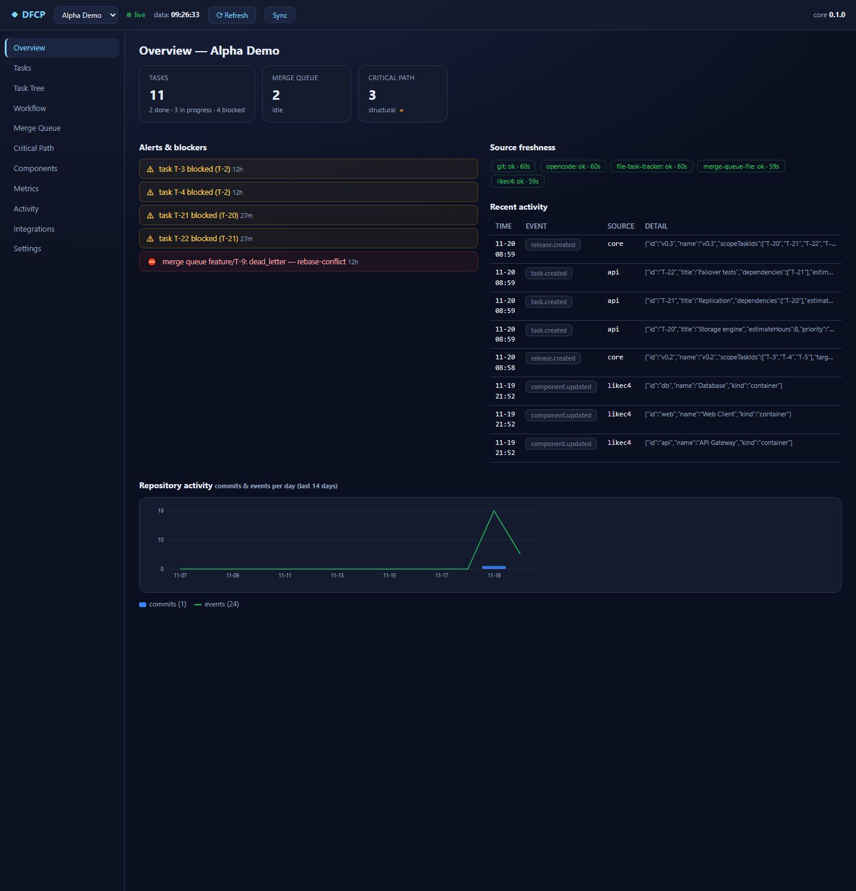
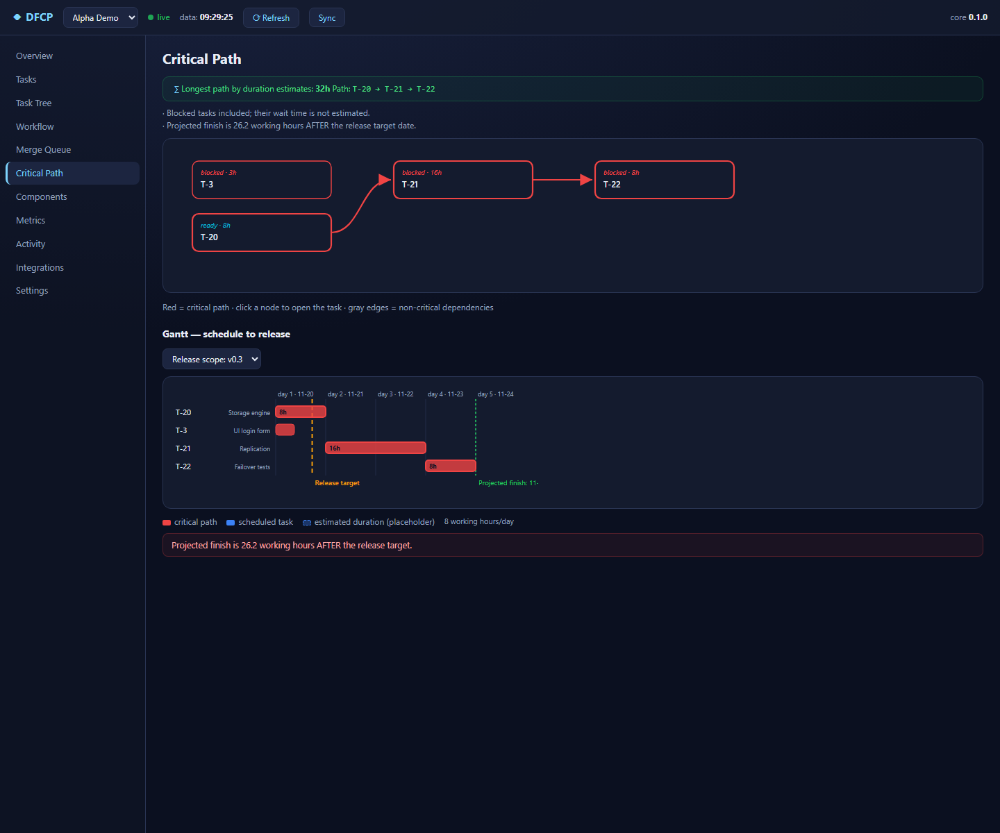
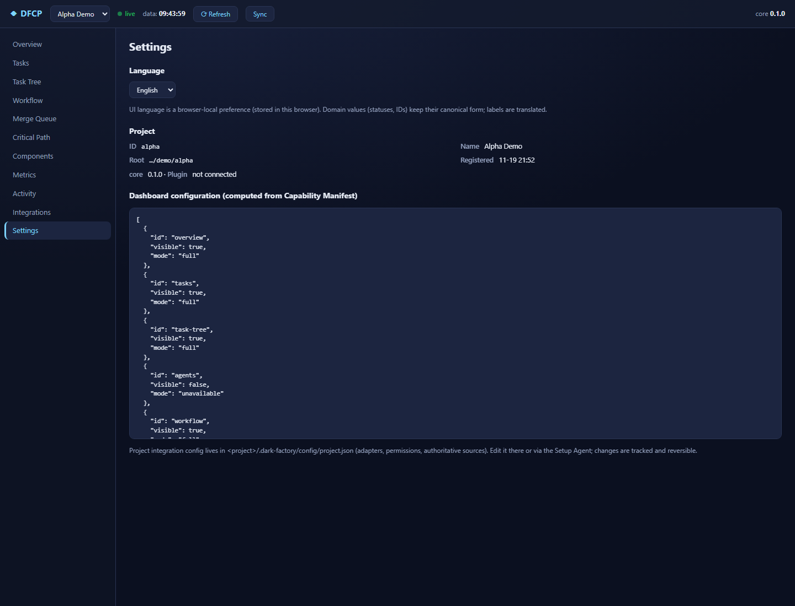
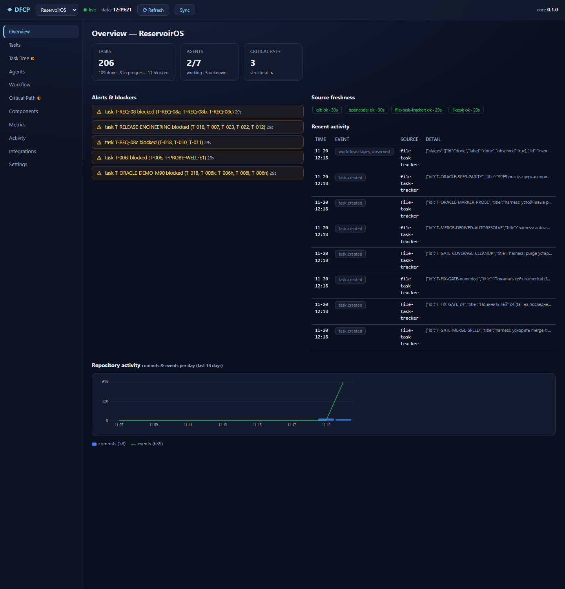
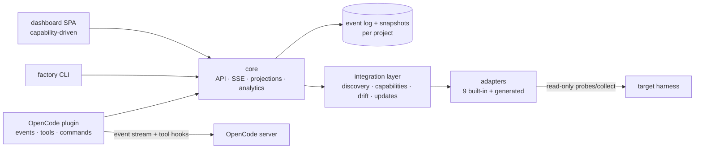

# Dark Factory Control Plane (DFCP)

**DFCP. An adaptive control plane for autonomous software development — for people, engineering harnesses and AI agents.**

[](https://github.com/AnsKaz-yu/Dark-Factory-Control-Plane/actions/workflows/ci.yml)
[](#testing)
[](#quick-start)
[](#vision)
[](#license)

*Dark Factory* — a development process where agents do the work and people keep control.
DFCP is the control plane: it **observes and manages** that process in any project, and
**adapts itself to the project's actual engineering harness** instead of forcing projects
into a predefined workflow.

- **For people:** a capability-driven dashboard — tasks, agents, workflow, pipelines, merge
  queue, critical path with a Gantt to the release target, releases, metrics, repository
  activity — in English or Russian.
- **For harnesses:** an adaptive integration layer. Discovery finds what your project really
  uses (OpenCode, custom trackers, Jenkins, GitHub/GitLab, LikeC4, home-grown queues…);
  adapters normalise it; drift detection keeps the integration honest as the harness evolves.
- **For AI agents:** a thin OpenCode plugin (`factory_*` tools, `/factory-*` commands), four
  kit agents and skills, and a typed event API. Agents propose and operate; the Core keeps
  the history and the truth.

Only **verified** capabilities are shown as working. Everything else is explicitly marked
partial / not configured / unavailable / stale / degraded — never fabricated.

### At a glance

| Stack |  |
| --- | --- |
| Runtime | Node.js ≥ 22.18, native TypeScript execution — **zero runtime dependencies** |
| Core | event-sourced: append-only log, idempotent ingestion, replay, verified snapshots |
| Storage | per-project JSONL event log + snapshots (local-first, `127.0.0.1` by default) |
| API | REST + SSE with `lastSeq` resume; typed, versioned event contracts (35 types) |
| UI | single-codebase vanilla-TS SPA, 14 sections, capability-driven, EN/RU |
| Integration | evidence-based discovery → Capability Manifest → 9 built-in adapters + generated project adapters |
| Evolution | harness fingerprint → drift (categories A/B/C) → reconciliation → adapter updates with rollback |
| OpenCode | V2 plugin API (tested on 1.19.5): event stream + tool hooks → typed DFCP events |
| Platforms | Windows, Linux, macOS (anything with Node ≥ 22.18 and git) |

| Metrics |  |
| --- | --- |
| Tests | **46 passing**: 27 unit (domain, events, projections, Gantt, activity, deploy fixes), 16 integration on synthetic harnesses, 3 end-to-end over HTTP |
| Harnesses exercised | 2 synthetic (standard OpenCode harness; substantially different custom harness) + a live clean deployment onto a real foreign project by an agent that knew only this repository |
| Event contracts | 35 registered types, per-type schema versions, unknown/incompatible events quarantined as diagnostics |
| Adapters | 9 built-in (git, opencode, file-task-tracker, merge-queue-file, likec4, jenkins, github, gitlab, generic-events) + contract-tested generated adapters |
| Dashboard | 14 sections; per-project configuration computed from the verified Capability Manifest |
| Safety | read-only discovery; writes confined to `.dark-factory/` + tracked `.opencode` additions; reversible uninstall; no secrets in manifests |

|  |  |
| --- | --- |
| [](docs/demo/en/overview.png) | [](docs/demo/en/critical-path-gantt.png) |
| Overview — tasks, agents, queue, critical path, alerts, per-source freshness, commits/events per day | Critical path — dependency DAG + Gantt to the release target; late finish flagged honestly |
| [](docs/demo/en/settings-language.png) | [](docs/deployment/reservoiros-overview.png) |
| Settings — UI language (English / Русский), project info, computed dashboard config | Clean deployment on a real project — 206 tasks from its live state, 2/7 agents working via the plugin |

Screenshots are captured from the running product (`?capture=1` mode). Russian versions:
[README.ru.md](README.ru.md).

---

## Vision

DFCP is a control plane, not a monolith and not a workflow imposition. The principles
(full text: [docs/architecture.md](docs/architecture.md), [docs/product-requirements.md](docs/product-requirements.md)):

1. **Adapt to the harness, never the reverse.** Discovery is read-only and evidence-based;
   adapters normalise what is common and preserve what is project-specific (original
   statuses, mapping rules, confidence).
2. **Honesty by construction.** A capability is `supported` only after a successful probe of
   the real interface. Missing estimates ⇒ structural analysis, labelled as such. Missing
   heartbeats ⇒ `unknown`, never `completed`.
3. **One authoritative source per entity.** Multiple sources may observe a capability; the
   project config declares the authoritative one and the conflict strategy. Auxiliary
   sources add, never overwrite.
4. **Observation survives harness evolution.** Fingerprint → drift → reconciliation →
   contract-tested adapter updates with rollback. History is never deleted.
5. **Observation is not orchestration.** DFCP does not dispatch agents or merge branches.
   Writes are explicit, permission-scoped API operations; the harness keeps its own loops.
6. **Zero dependencies, local-first.** Node's native TypeScript execution; append-only log
   as the database; loopback binding; no telemetry leaves the machine.

| Area | Status |
| --- | --- |
| Event-sourced core: ingestion, dedup, replay, snapshots, diagnostics quarantine | ✅ |
| Task management: hierarchy ≠ dependencies, claim/release, acceptance criteria, history | ✅ |
| Agent monitoring: 8 statuses, evidence tracking, sessions, heartbeats | ✅ |
| Workflow (observed stages), Git, CI/CD (Jenkins/GitHub/GitLab), merge queue | ✅ |
| Critical path + Gantt to release target; release readiness; metrics; repository activity | ✅ |
| Components + LikeC4 architecture map (optional source) | ✅ |
| Discovery → Capability Manifest → adapter selection/generation (contract-tested) | ✅ |
| Fingerprint, drift A/B/C, reconciliation, adapter updates + rollback | ✅ |
| OpenCode plugin: event forwarding, 12 `factory_*` tools, commands, kit (4 agents + 4 skills) | ✅ |
| Capability-driven dashboard, EN/RU, SSE live updates, capture mode | ✅ |
| CLI lifecycle: setup/discover/sync/doctor/reconcile/diff/adapter:\*/uninstall | ✅ |
| Clean deployment verified on a foreign live project ([report](docs/deployment/reservoiros-clean-deploy-report.md), [fixes](docs/deployment/friction-fixes.md)) | ✅ |
| Composite sources spanning multiple repositories (sibling harness repos) | ⚠️ documented v1 boundary: discovery root is the project; cross-repo sources need explicit adapter config |

## Contents

- [Vision](#vision)
- [Features](#features)
- [Quick start](#quick-start)
- [Using DFCP](#using-dfcp)
- [Architecture](#architecture)
- [Development](#development)
- [Testing](#testing)
- [Project layout](#project-layout)
- [Documentation](#documentation)
- [Contributing](#contributing)
- [License](#license)

## Features

**Work management**

- Epic → Feature → Task → Subtask tree, kept separate from the dependency DAG.
- Statuses normalised across harnesses with originals preserved (`sourceStatus`, mapping
  rule version, confidence); priorities, assignees, estimates with confidence, labels.
- Atomic claim/release (409 on conflict), acceptance criteria, saved filters, full history,
  links to branches / PRs / pipeline runs / releases.
- Releases with scope and a readiness verdict backed by an evidence list; `insufficient_data`
  is a first-class verdict.

**Observability**

- Overview KPIs, blockers and alerts, per-source freshness badges (ok / stale / degraded).
- Workflow view built from **observed** stages and transitions — not an imposed pipeline.
- Jenkins-like pipeline runs with stages/jobs; merge queue FIFO board with dead-letter
  reasons; Task / Pipeline / Merge shown as independent states.
- Critical path DAG + **Gantt schedule to the release target** (working-day axis, target and
  projected-finish lines, estimated durations dashed, late-finish alert).
- Repository activity: commits/day + events/day; metrics with per-metric coverage notes.
- Activity timeline over the raw event log; SSE live updates with gap-free resume.

**Adaptive integration**

- Read-only, evidence-based discovery (configs, script content, data structure, docs, logs);
  never executes project scripts; deterministic on large repositories.
- Capability Manifest with seven statuses and probe-verified confidence.
- 9 built-in adapters; generated project-specific adapters for custom formats, contract-tested
  in isolation before activation, versioned, rollback-able.
- Harness fingerprint (no secrets, no business code), economical drift detection,
  reconciliation with categories A (auto) / B (reversible, tested) / C (approval required).
- Failure isolation: one broken adapter degrades only its capabilities.

**OpenCode kit**

- Thin plugin: registers the project, forwards the server event stream and tool executions
  as typed events, keeps agent/session linkage and heartbeats.
- 12 `factory_*` tools and `/factory-*` commands; kit agents (setup / operations /
  diagnostics / maintenance) and matching skills, installed additively and tracked.
- Project id dedup by root + aliases, so plugin and CLI never create duplicate projects and
  older plugin instances keep working after merges.

**Honesty & safety**

- Writes confined to `.dark-factory/` and tracked `.opencode` additions; local-only
  `.git/info/exclude` entry; reversible uninstall removes only manifest-tracked paths.
- No secrets in manifests or adapters (credentials referenced by env var name).
- Unknown/incompatible events quarantined as diagnostics, never applied; corrupt log lines
  preserved, never destroyed.

## Quick start

Requirements: **Node.js ≥ 22.18** and **git**. OpenCode is optional (the Core runs standalone).
No `npm install` needed — zero runtime dependencies.

### Option A — paste this prompt to an agent in your project (recommended)

Copy the block below into any coding agent running in the project you want to connect
(full file: [AGENT-QUICKSTART.md](AGENT-QUICKSTART.md)):

```text
Deploy Dark Factory Control Plane (DFCP) into THIS project.
1. Clone https://github.com/AnsKaz-yu/Dark-Factory-Control-Plane.git into a sibling directory
   (e.g. ../dark-factory-control-plane). Never clone inside this repo's tracked tree.
2. Read its README.md "Quick start" and packages/plugin/INSTALL.md.
   Ensure Node >= 22.18 and git are available.
3. Start the core: node <clone>/packages/cli/src/serve.ts --port 8095
   (if http://127.0.0.1:8095/api/health is already healthy, reuse that core).
4. Install the plugin into THIS project: copy <clone>/packages/plugin to
   .opencode/plugins/dark-factory/ (additive only; do NOT edit opencode.json or any tracked file).
5. Run: node <clone>/packages/cli/src/main.ts setup --root .
   Discovery is read-only; writes go only to .dark-factory/ and .opencode kit additions.
6. Verify: node <clone>/packages/cli/src/main.ts doctor --project <id>, then open
   http://127.0.0.1:8095/#/<id>. Report the capability matrix and limitations honestly.
Constraints: no git commits/branch changes in this repo; do not execute this repo's scripts;
no npm install here. Uninstall later: factory uninstall --root . --yes (tracked files only).
```

### Option B — CLI, no OpenCode

```bash
git clone https://github.com/AnsKaz-yu/Dark-Factory-Control-Plane.git
cd Dark-Factory-Control-Plane
npm run build                      # dashboard assets (Node type stripper, no deps)
npm start                          # core + integration layer on 127.0.0.1:8095
# in another shell, from the product dir:
npm run factory -- setup --root /path/to/your/project
npm run factory -- doctor --project your-project
npm run factory -- dashboard --project your-project
```

### Option C — OpenCode plugin manually

Add to the project's (or global) `opencode.json(c)`:

```jsonc
{ "plugins": [ { "package": "/abs/path/Dark-Factory-Control-Plane/packages/plugin",
                 "options": { "coreUrl": "http://127.0.0.1:8095" } } ] }
```

or copy `packages/plugin` into `.opencode/plugins/dark-factory/`, then run `/factory-setup`.
Details: [packages/plugin/INSTALL.md](packages/plugin/INSTALL.md).

## Using DFCP

| Surface | What you get |
| --- | --- |
| Dashboard `http://127.0.0.1:8095/#/<project>` | 14 capability-driven sections; Settings → language EN/RU; `?lang=` shareable links |
| `factory_*` tools (OpenCode) | setup, discover, status, task (list/get/create/update/claim/release), map, sync, doctor, reconcile, adapter_update, adapter_status, integration_diff, dashboard |
| `/factory-*` commands | setup, status, dashboard, doctor, sync, reconcile, plus `/factory <subcommand>` |
| `factory` CLI | full lifecycle incl. `adapter:generate`, `adapter:rollback`, `diff`, `uninstall` — [docs/cli.md](docs/cli.md) |
| REST API | `/api/projects…`, events ingestion, SSE stream — [docs/specs/event-contracts.md](docs/specs/event-contracts.md) |

Keyboard/UI: `/` focuses search, `Esc` closes modals; every value carries its nature
(real / computed ∑ / estimated ≈ / missing —) and every source its freshness.

## Architecture

One Node process hosts the Core; adapters are modules; the plugin is a thin HTTP client.
The append-only event log **is** the database; projections rebuild from it.



| Package | Responsibility |
| --- | --- |
| `packages/core` | domain types (single DTO source), event contracts + validators, event store, projections, analytics (readiness, critical path + Gantt, release readiness, metrics, repo activity), REST/SSE, dashboard server |
| `packages/adapters` | adapter contract + built-ins; restricted read-only context (confined fs, whitelisted git, env-referenced credentials) |
| `packages/integration` | discovery, capability manifest, fingerprint/drift, reconciliation, update manager + rollback, adapter generator, install/uninstall |
| `packages/cli` | `factory` command line; full-product server entry |
| `packages/plugin` | thin OpenCode plugin + kit (agents, skills) |
| `packages/dashboard` | vanilla-TS SPA; zero-dependency build via Node's type stripper |

Extension points: the `Adapter` contract ([guide](docs/specs/adapter-development-guide.md))
and the event registry ([spec](docs/specs/event-contracts.md)). New harness types plug in
without touching the Core.

## Development

```bash
npm run build        # dashboard bundle
npm test             # all 46 tests (unit + integration + e2e)
npm run test:unit    # domain / events / projections / Gantt / deploy fixes
npm run test:integration  # synthetic harnesses: discovery, drift, updates, isolation
npm run test:e2e     # full product over HTTP
npm run docs:events  # regenerate event-contract spec from the live registry
npm start            # core + integration layer
```

Conventions: zero runtime dependencies; erasable TypeScript only (no enums/namespaces);
single DTO source with validators at every boundary; all derivation server-side; tests use
synthetic fixtures inside `tests/.runtime/` (gitignored) — never real repositories.

## Testing

| Level | What is checked |
| --- | --- |
| Unit (27) | ids/hashing, event dedup/replay/snapshot integrity, schema validation, projections (claim/auto-unblock/heartbeat semantics), Gantt forward pass + release lateness, repo activity buckets, deploy fixes (root dedup, aliases, likec4 wrapper, source refresh, uninstall safety, git exclude) |
| Integration (16) | two synthetic harnesses: discovery → manifest → adapter selection/generation → sync; drift A/B/C + reconciliation; failure isolation; history preservation across restarts; multi-project isolation; authoritative-source strategy; uninstall |
| E2E (3) | full lifecycle over HTTP exactly as plugin/CLI use it: register → discover → verify → plugin connect → ingestion (idempotent) → task ops → dashboard config → drift → reconcile → adapter update/rollback → SSE resume → static assets; diagnostics quarantine |

Live evidence beyond tests: a clean deployment onto a real foreign project by an agent that
knew only this repository — [report](docs/deployment/reservoiros-clean-deploy-report.md),
[friction fixes](docs/deployment/friction-fixes.md).

## Project layout

```
.
├── packages/
│   ├── core/          # domain, events, projections, analytics, API, dashboard server
│   ├── adapters/      # contract + 9 built-in adapters
│   ├── integration/   # discovery, capabilities, drift, reconciliation, updates, install
│   ├── cli/           # factory CLI + full-product server entry
│   ├── plugin/        # OpenCode plugin + kit/ (agents, skills)
│   └── dashboard/     # SPA source + zero-dep build
├── docs/              # requirements, architecture, specs, guides, deployment reports
├── tests/             # unit / integration / e2e + synthetic harness fixtures
├── research/          # read-only legacy plugin snapshots + reverse-engineering report
├── scripts/           # spec generation from live code
├── AGENT-QUICKSTART.md# copy-paste agent prompt for deployment
└── .github/workflows/ # CI
```

## Documentation

[Docs index](docs/README.md): product requirements · architecture & ADRs · UX/UI ·
event contracts · capability manifest · harness discovery · adapter development guide ·
reconciliation & updates · security model · installation · CLI · plugin · troubleshooting ·
migration · release · deployment reports.

## Contributing

Issues and PRs welcome. Keep the invariants: zero runtime deps, typed contracts, honesty
(no unverified capability shown as working), confined reversible writes, tests for every
behaviour change. See [docs/specs/adapter-development-guide.md](docs/specs/adapter-development-guide.md)
for adding harness support without touching the Core.

## License

[MIT](LICENSE).
