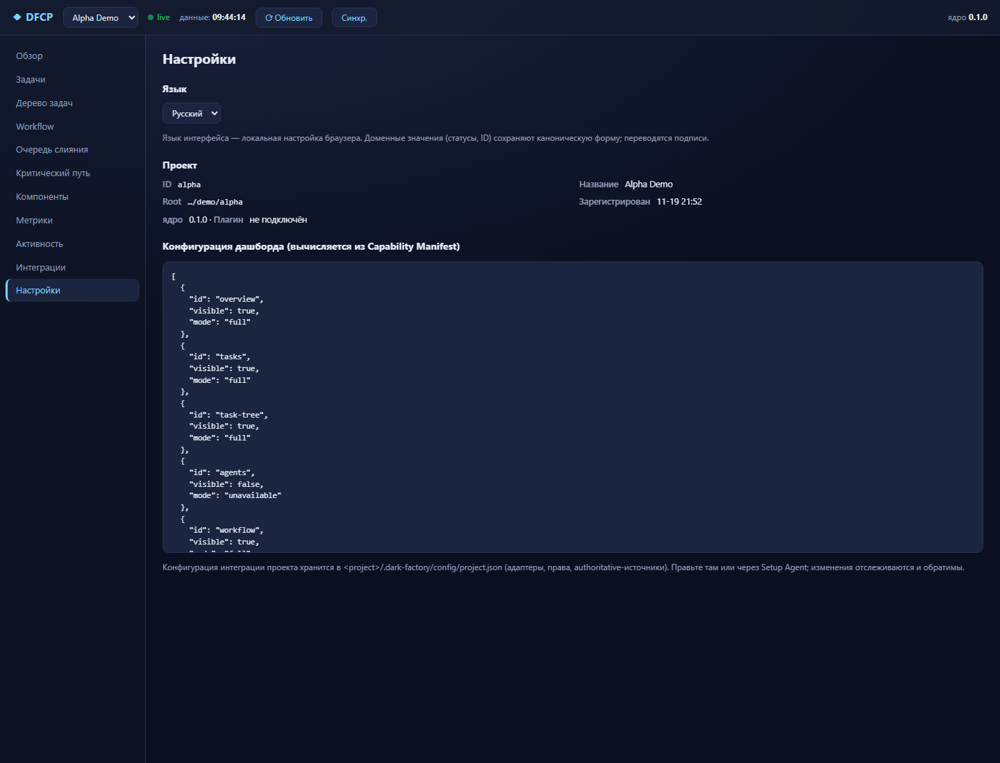

# Dark Factory Control Plane (DFCP)

**Платформа управления инженерными работами и наблюдаемости для автономной разработки.**

DFCP наблюдает и управляет процессом разработки любого проекта — задачи, агенты, workflow,
Git, CI/CD, очереди слияния, релизы и критический путь — и **адаптируется к фактическому
инженерному harness проекта**, а не заставляет проекты подстраиваться под заранее заданный
workflow.

> Статус: активная разработка. Требования, архитектура и спецификации — в `docs/`.

## Ключевые идеи

- **Core Product** — самостоятельный event-sourced сервер: доменная модель, приём событий,
  проекции состояния, управление задачами, метрики, REST API, capability-driven веб-дашборд.
  Работает независимо от OpenCode.
- **Adaptive Integration Layer** — исследование harness, capability manifest, реестр адаптеров
  (встроенные + генерируемые проектно-специфичные), fingerprinting harness, обнаружение drift,
  reconciliation и управление обновлениями адаптеров с откатом.
- **OpenCode Integration Kit** — тонкий плагин (регистрация проекта, передача событий,
  команды), агенты setup/operations/diagnostics и навыки.
- **Capability-driven UI** — одна кодовая база; дашборд каждого проекта конфигурируется из
  его верифицированного Capability Manifest. Неподдерживаемые функции никогда не показываются
  как работающие.

## Принципы

1. Нормализуй общее, сохраняй проектно-специфичное.
2. Никогда не показывай непроверенные данные как факт.
3. Один authoritative источник на сущность; явная стратегия конфликтов при нескольких источниках.
4. Наблюдение должно переживать эволюцию harness: обнаруживай drift, выполняй reconciliation,
   обновляй адаптеры, сохраняй историю.
5. Ноль runtime-зависимостей (Node.js ≥ 22.18, нативное исполнение TypeScript).

## Структура репозитория

```
packages/
  core/        Core Product: доменная модель, события, проекции, аналитика, API, сервер дашборда
  adapters/    Встроенные адаптеры (git, opencode, file-task-tracker, jenkins, github, gitlab, likec4, ...)
  integration/ Discovery, capability manifest, fingerprint, drift, reconciliation, обновления
  cli/         factory CLI (setup/discover/sync/doctor/reconcile/adapter:*/...)
  plugin/      OpenCode-плагин (тонкий) + kit/ (агенты и навыки для целевых проектов)
  dashboard/   Capability-driven SPA (сборка без зависимостей через Node type stripper)
docs/          Требования, архитектура, спецификации, руководства, отчёт демонстрации
tests/         Unit / integration / e2e + synthetic harness fixtures
research/      Read-only снапшоты legacy-плагина + отчёт о reverse engineering
scripts/       Генерация спецификаций из живого кода
```

## Быстрый старт (разработка)

```bash
node packages/cli/src/main.ts --help
node packages/core/src/main.ts --port 8095 --data .dfcp-data
```

Индекс документации: [`docs/README.md`](docs/README.md).

## Скриншоты

Capability-driven обзор с активностью репозитория (коммиты и события по дням):


Критический путь с диаграммой Ганта до целевой даты релиза (опоздание честно помечается):


Настройки — выбор языка интерфейса (English / Русский):



## Лицензия

MIT — см. [LICENSE](LICENSE).
