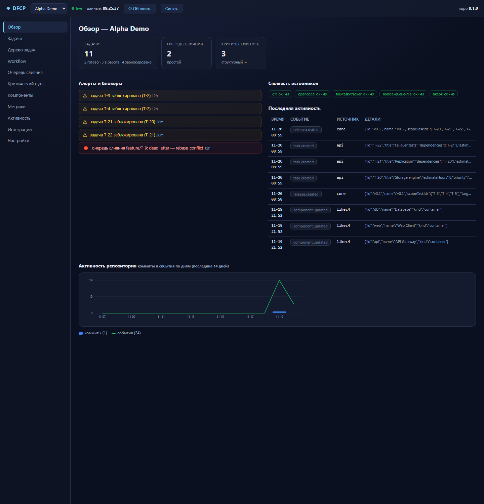
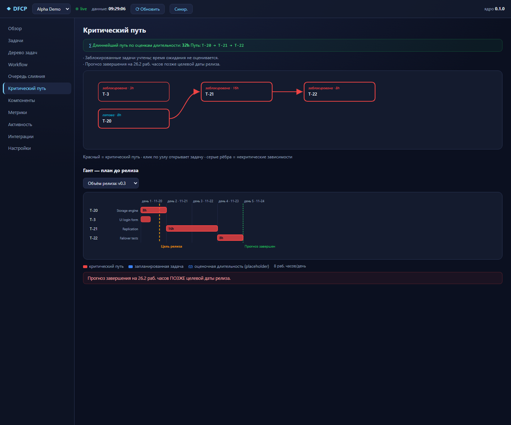
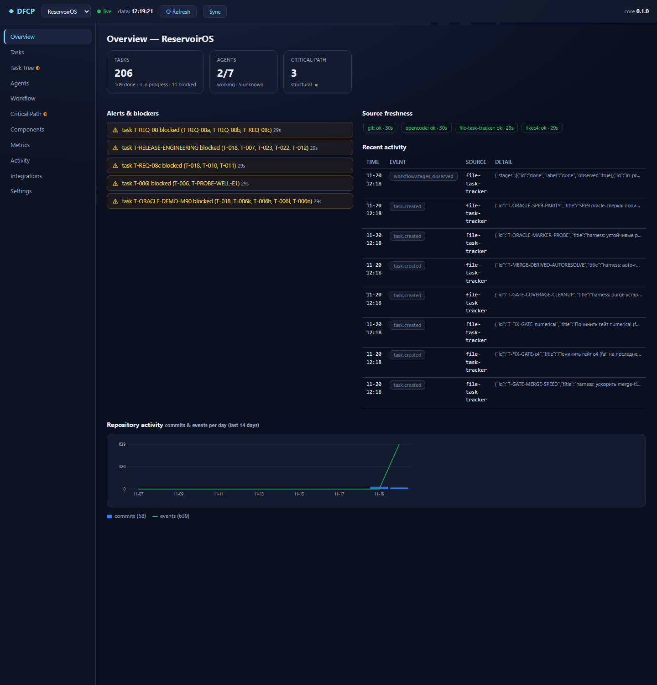
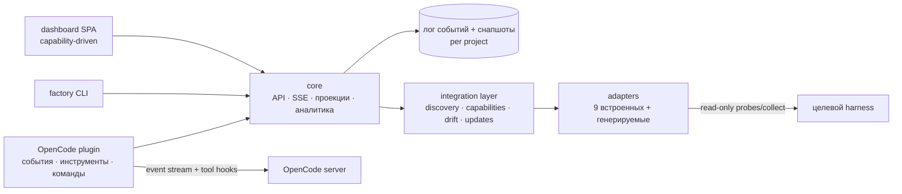

# Dark Factory Control Plane (DFCP)

**DFCP. Адаптивная панель управления автономной разработкой — для людей, инженерных harness и AI-агентов.**

[](https://github.com/AnsKaz-yu/Dark-Factory-Control-Plane/actions/workflows/ci.yml)
[](#тестирование)
[](#быстрый-старт)
[](#видение)
[](#лицензия)

*Dark Factory* — процесс разработки, где работу делают агенты, а контроль остаётся у людей.
DFCP — панель управления: она **наблюдает и управляет** этим процессом в любом проекте и
**адаптируется к фактическому инженерному harness проекта**, а не заставляет проекты
подстраиваться под заранее заданный workflow.

- **Для людей:** capability-driven дашборд — задачи, агенты, workflow, пайплайны, очередь
  слияния, критический путь с диаграммой Ганта до цели релиза, релизы, метрики, активность
  репозитория — на русском или английском.
- **Для harness:** адаптивный интеграционный слой. Discovery находит, что проект реально
  использует (OpenCode, кастомные трекеры, Jenkins, GitHub/GitLab, LikeC4, самописные
  очереди…); адаптеры нормализуют данные; drift-детекция держит интеграцию честной по мере
  эволюции harness.
- **Для AI-агентов:** тонкий OpenCode-плагин (инструменты `factory_*`, команды `/factory-*`),
  четыре kit-агента и навыка, типизированный event API. Агенты предлагают и выполняют;
  ядро хранит историю и истину.

Как работающие показываются **только подтверждённые** возможности. Остальное явно помечено
partial / not configured / unavailable / stale / degraded — никогда не выдумывается.

### Кратко

| Стек |  |
| --- | --- |
| Runtime | Node.js ≥ 22.18, нативное исполнение TypeScript — **ноль runtime-зависимостей** |
| Ядро | event-sourced: append-only лог, идемпотентный приём, replay, верифицированные снапшоты |
| Хранение | per-project JSONL-лог событий + снапшоты (local-first, по умолчанию `127.0.0.1`) |
| API | REST + SSE с resume по `lastSeq`; типизированные версионированные контракты событий (35 типов) |
| UI | одна кодовая база, vanilla-TS SPA, 14 разделов, capability-driven, RU/EN |
| Интеграция | evidence-based discovery → Capability Manifest → 9 встроенных адаптеров + генерируемые проектные |
| Эволюция | fingerprint harness → drift (категории A/B/C) → reconciliation → обновления адаптеров с откатом |
| OpenCode | V2 plugin API (проверено на 1.19.5): поток событий + tool hooks → типизированные события DFCP |
| Платформы | Windows, Linux, macOS (всё, где есть Node ≥ 22.18 и git) |

| Метрики |  |
| --- | --- |
| Тесты | **46 passing**: 27 unit (домен, события, проекции, Гант, активность, фиксы развёртывания), 16 integration на synthetic harness, 3 end-to-end по HTTP |
| Проверенные harness | 2 synthetic (стандартный OpenCode harness; существенно иной кастомный) + живое «чистое» развёртывание на реальном чужом проекте агентом, знавшим только этот репозиторий |
| Контракты событий | 35 зарегистрированных типов, версии схем по типам, неизвестные/несовместимые события карантинятся как диагностики |
| Адаптеры | 9 встроенных (git, opencode, file-task-tracker, merge-queue-file, likec4, jenkins, github, gitlab, generic-events) + генерируемые с contract-тестами |
| Дашборд | 14 разделов; конфигурация per-project вычисляется из верифицированного Capability Manifest |
| Безопасность | read-only discovery; записи только в `.dark-factory/` + отслеживаемые добавления `.opencode`; обратимый uninstall; без секретов в манифестах |

|  |  |
| --- | --- |
| [](docs/demo/ru/overview.png) | [](docs/demo/ru/critical-path-gantt.png) |
| Обзор — задачи, агенты, очередь, критический путь, алерты, свежесть источников, коммиты/события по дням | Критический путь — DAG зависимостей + Гант до цели релиза; опоздание честно помечается |
| [](docs/demo/ru/settings-language.png) | [](docs/deployment/reservoiros-overview.png) |
| Настройки — язык интерфейса (Русский / English), информация о проекте, вычисленная конфигурация дашборда | «Чистое» развёртывание на реальном проекте — 206 задач из его живого состояния, 2/7 агентов в работе через плагин |

Скриншоты сняты с работающего продукта (режим `?capture=1`). Английская версия:
[README.md](README.md).

---

## Видение

DFCP — панель управления, а не монолит и не навязывание workflow. Принципы
(полный текст: [docs/architecture.md](docs/architecture.md), [docs/product-requirements.md](docs/product-requirements.md)):

1. **Адаптируйся к harness, а не наоборот.** Discovery read-only и evidence-based;
   адаптеры нормализуют общее и сохраняют проектно-специфичное (оригинальные статусы,
   правила маппинга, уверенность).
2. **Честность по построению.** Возможность `supported` только после успешного probe
   реального интерфейса. Нет оценок ⇒ структурный анализ с явной пометкой. Нет heartbeat ⇒
   `unknown`, никогда `completed`.
3. **Один authoritative источник на сущность.** Несколько источников могут наблюдать
   возможность; конфиг проекта объявляет authoritative и стратегию конфликтов.
   Вспомогательные источники добавляют, но не перезаписывают.
4. **Наблюдение переживает эволюцию harness.** Fingerprint → drift → reconciliation →
   contract-тестированные обновления адаптеров с откатом. История не удаляется.
5. **Наблюдение — не оркестрация.** DFCP не диспетчеризует агентов и не мержит ветки.
   Записи — явные permission-scoped операции API; свои циклы остаются у harness.
6. **Ноль зависимостей, local-first.** Нативный TypeScript Node; append-only лог как база;
   loopback-биндинг; телеметрия не покидает машину.

| Область | Статус |
| --- | --- |
| Event-sourced ядро: приём, дедуп, replay, снапшоты, карантин диагностик | ✅ |
| Управление задачами: иерархия ≠ зависимости, claim/release, критерии приёмки, история | ✅ |
| Мониторинг агентов: 8 статусов, evidence, сессии, heartbeat | ✅ |
| Workflow (наблюдаемые стадии), Git, CI/CD (Jenkins/GitHub/GitLab), очередь слияния | ✅ |
| Критический путь + Гант до цели релиза; готовность релизов; метрики; активность репозитория | ✅ |
| Компоненты + карта архитектуры LikeC4 (опциональный источник) | ✅ |
| Discovery → Capability Manifest → выбор/генерация адаптеров (contract-тесты) | ✅ |
| Fingerprint, drift A/B/C, reconciliation, обновления адаптеров + откат | ✅ |
| OpenCode-плагин: форвардинг событий, 12 инструментов `factory_*`, команды, kit (4 агента + 4 навыка) | ✅ |
| Capability-driven дашборд, RU/EN, SSE live, режим capture | ✅ |
| CLI lifecycle: setup/discover/sync/doctor/reconcile/diff/adapter:\*/uninstall | ✅ |
| «Чистое» развёртывание проверено на реальном чужом проекте ([отчёт](docs/deployment/reservoiros-clean-deploy-report.md), [фиксы](docs/deployment/friction-fixes.md)) | ✅ |
| Композитные источники поверх нескольких репозиториев (sibling harness) | ⚠️ документированная граница v1: корень discovery — проект; cross-repo источники требуют явного конфига адаптера |

## Содержание

- [Видение](#видение)
- [Возможности](#возможности)
- [Быстрый старт](#быстрый-старт)
- [Использование](#использование)
- [Архитектура](#архитектура)
- [Разработка](#разработка)
- [Тестирование](#тестирование)
- [Структура проекта](#структура-проекта)
- [Документация](#документация)
- [Вклад](#вклад)
- [Лицензия](#лицензия)

## Возможности

**Управление работами**

- Дерево Epic → Feature → Task → Subtask, отдельно от DAG зависимостей.
- Статусы нормализуются между harness с сохранением оригиналов (`sourceStatus`, версия
  правил маппинга, уверенность); приоритеты, исполнители, оценки с уверенностью, метки.
- Атомарные claim/release (409 при конфликте), критерии приёмки, фильтры, полная история,
  связи с ветками / PR / прогонами пайплайнов / релизами.
- Релизы с объёмом и вердиктом готовности на списке доказательств; `insufficient_data` —
  полноправный вердикт.

**Наблюдаемость**

- KPI обзора, блокеры и алерты, бейджи свежести источников (ok / stale / degraded).
- Workflow из **наблюдаемых** стадий и переходов — не навязанный pipeline.
- Прогоны пайплайнов со стадиями/джобами в стиле Jenkins; FIFO-доска очереди слияния с
  причинами dead-letter; Task / Pipeline / Merge — независимые состояния.
- DAG критического пути + **Гант до цели релиза** (ось рабочих дней, линии цели и прогноза,
  штриховка оценочных длительностей, алерт при опоздании).
- Активность репозитория: коммиты/день + события/день; метрики с coverage-заметками.
- Лента активности по сырому логу событий; SSE live с resume без пропусков.

**Адаптивная интеграция**

- Read-only evidence-based discovery (конфиги, содержимое скриптов, структура данных, docs,
  логи); никогда не исполняет скрипты проекта; детерминирован на больших репозиториях.
- Capability Manifest с семью статусами и probe-подтверждённой уверенностью.
- 9 встроенных адаптеров; генерируемые проектные адаптеры для кастомных форматов,
  contract-тесты в изоляции перед активацией, версии, откат.
- Fingerprint harness (без секретов и бизнес-кода), экономная drift-детекция,
  reconciliation с категориями A (авто) / B (обратимо, с тестами) / C (нужно подтверждение).
- Изоляция сбоев: сломанный адаптер деградирует только свои возможности.

**OpenCode kit**

- Тонкий плагин: регистрирует проект, форвардит поток событий сервера и исполнения
  инструментов как типизированные события, держит связку агентов/сессий и heartbeat.
- 12 инструментов `factory_*` и команды `/factory-*`; kit-агенты (setup / operations /
  diagnostics / maintenance) и навыки, устанавливаются аддитивно и отслеживаются.
- Dedup проектов по root + алиасы id: плагин и CLI не создают дублей, старые инстансы
  плагина продолжают работать после слияний.

**Честность и безопасность**

- Записи только в `.dark-factory/` и отслеживаемые добавления `.opencode`; локальная запись
  в `.git/info/exclude`; обратимый uninstall удаляет только пути из manifest.
- Без секретов в манифестах и адаптерах (credentials по имени env-переменной).
- Неизвестные/несовместимые события карантинятся как диагностики и не применяются;
  повреждённые строки лога сохраняются, не уничтожаются.

## Быстрый старт

Требования: **Node.js ≥ 22.18** и **git**. OpenCode опционален (ядро работает самостоятельно).
`npm install` не нужен — ноль runtime-зависимостей.

### Вариант A — вставьте этот промт агенту в вашем проекте (рекомендуется)

Скопируйте блок ниже любому coding-агенту, работающему в проекте, который хотите подключить
(полный файл: [AGENT-QUICKSTART.md](AGENT-QUICKSTART.md)):

```text
Разверни Dark Factory Control Plane (DFCP) в ЭТОМ проекте.
1. Клонируй https://github.com/AnsKaz-yu/Dark-Factory-Control-Plane.git в соседний каталог
   (например ../dark-factory-control-plane). Не клонируй внутрь отслеживаемого дерева этого репо.
2. Прочитай его README.md «Quick start» и packages/plugin/INSTALL.md.
   Убедись, что доступны Node >= 22.18 и git.
3. Запусти ядро: node <clone>/packages/cli/src/serve.ts --port 8095
   (если http://127.0.0.1:8095/api/health уже healthy — используй это ядро).
4. Установи плагин в ЭТОТ проект: скопируй <clone>/packages/plugin в
   .opencode/plugins/dark-factory/ (только аддитивно; НЕ правь opencode.json и отслеживаемые файлы).
5. Выполни: node <clone>/packages/cli/src/main.ts setup --root .
   Discovery read-only; записи только в .dark-factory/ и kit-добавления .opencode.
6. Проверь: node <clone>/packages/cli/src/main.ts doctor --project <id>, затем открой
   http://127.0.0.1:8095/#/<id>. Честно отчитайся о матрице возможностей и ограничениях.
Ограничения: без git-коммитов/смены веток в этом репо; не исполняй скрипты этого репо;
без npm install здесь. Удаление позже: factory uninstall --root . --yes (только tracked-файлы).
```

### Вариант B — CLI, без OpenCode

```bash
git clone https://github.com/AnsKaz-yu/Dark-Factory-Control-Plane.git
cd Dark-Factory-Control-Plane
npm run build                      # ассеты дашборда (Node type stripper, без зависимостей)
npm start                          # ядро + интеграционный слой на 127.0.0.1:8095
# в другом шелле, из каталога продукта:
npm run factory -- setup --root /path/to/your/project
npm run factory -- doctor --project your-project
npm run factory -- dashboard --project your-project
```

### Вариант C — OpenCode-плагин вручную

Добавьте в `opencode.json(c)` проекта (или глобальный):

```jsonc
{ "plugins": [ { "package": "/abs/path/Dark-Factory-Control-Plane/packages/plugin",
                 "options": { "coreUrl": "http://127.0.0.1:8095" } } ] }
```

или скопируйте `packages/plugin` в `.opencode/plugins/dark-factory/`, затем `/factory-setup`.
Подробности: [packages/plugin/INSTALL.md](packages/plugin/INSTALL.md).

## Использование

| Поверхность | Что даёт |
| --- | --- |
| Дашборд `http://127.0.0.1:8095/#/<project>` | 14 capability-driven разделов; Настройки → язык RU/EN; ссылки `?lang=` |
| Инструменты `factory_*` (OpenCode) | setup, discover, status, task (list/get/create/update/claim/release), map, sync, doctor, reconcile, adapter_update, adapter_status, integration_diff, dashboard |
| Команды `/factory-*` | setup, status, dashboard, doctor, sync, reconcile + `/factory <подкоманда>` |
| CLI `factory` | полный lifecycle, включая `adapter:generate`, `adapter:rollback`, `diff`, `uninstall` — [docs/cli.md](docs/cli.md) |
| REST API | `/api/projects…`, приём событий, SSE-поток — [docs/specs/event-contracts.md](docs/specs/event-contracts.md) |

Каждое значение несёт свою природу (real / computed ∑ / estimated ≈ / missing —), каждый
источник — свою свежесть.

## Архитектура

Один Node-процесс держит ядро; адаптеры — модули; плагин — тонкий HTTP-клиент.
Append-only лог событий **и есть** база; проекции пересобираются из него.



| Пакет | Ответственность |
| --- | --- |
| `packages/core` | типы домена (единый источник DTO), контракты событий + валидаторы, event store, проекции, аналитика (readiness, критический путь + Гант, готовность релизов, метрики, активность репо), REST/SSE, сервер дашборда |
| `packages/adapters` | контракт адаптера + встроенные; ограниченный read-only контекст (confined fs, whitelisted git, credentials по env) |
| `packages/integration` | discovery, capability manifest, fingerprint/drift, reconciliation, update manager + откат, генератор адаптеров, install/uninstall |
| `packages/cli` | командная строка `factory`; entry полного продукта |
| `packages/plugin` | тонкий OpenCode-плагин + kit/ (агенты, навыки) |
| `packages/dashboard` | vanilla-TS SPA; сборка без зависимостей через type stripper Node |

Точки расширения: контракт `Adapter` ([guide](docs/specs/adapter-development-guide.md))
и реестр событий ([spec](docs/specs/event-contracts.md)). Новые типы harness подключаются
без правок ядра.

## Разработка

```bash
npm run build        # бандл дашборда
npm test             # все 46 тестов (unit + integration + e2e)
npm run test:unit    # домен / события / проекции / Гант / фиксы развёртывания
npm run test:integration  # synthetic harness: discovery, drift, updates, isolation
npm run test:e2e     # полный продукт по HTTP
npm run docs:events  # регенерация спецификации контрактов из живого реестра
npm start            # ядро + интеграционный слой
```

Соглашения: ноль runtime-зависимостей; только erasable TypeScript (без enums/namespaces);
единый источник DTO с валидаторами на каждой границе; вся производная логика на сервере;
тесты на synthetic fixtures в `tests/.runtime/` (gitignored) — никогда на реальных репо.

## Тестирование

| Уровень | Что проверяется |
| --- | --- |
| Unit (27) | ids/хеши, дедуп/replay/целостность снапшотов, валидация схем, проекции (claim/auto-unblock/семантика heartbeat), forward pass Ганта + опоздание релиза, бакеты активности репо, фиксы развёртывания (dedup по root, алиасы, обёртка likec4, source refresh, безопасность uninstall, git exclude) |
| Integration (16) | два synthetic harness: discovery → manifest → выбор/генерация адаптеров → sync; drift A/B/C + reconciliation; изоляция сбоев; сохранение истории через рестарты; изоляция проектов; стратегия authoritative; uninstall |
| E2E (3) | полный lifecycle по HTTP как у плагина/CLI: register → discover → verify → plugin connect → приём (идемпотентный) → операции задач → dashboard config → drift → reconcile → update/rollback адаптера → SSE resume → статика; карантин диагностик |

Живые свидетельства сверх тестов: «чистое» развёртывание на реальном чужом проекте агентом,
знавшим только этот репозиторий — [отчёт](docs/deployment/reservoiros-clean-deploy-report.md),
[фиксы friction](docs/deployment/friction-fixes.md).

## Структура проекта

```
.
├── packages/
│   ├── core/          # домен, события, проекции, аналитика, API, сервер дашборда
│   ├── adapters/      # контракт + 9 встроенных адаптеров
│   ├── integration/   # discovery, capabilities, drift, reconciliation, updates, install
│   ├── cli/           # factory CLI + entry полного продукта
│   ├── plugin/        # OpenCode-плагин + kit/ (агенты, навыки)
│   └── dashboard/     # исходники SPA + сборка без зависимостей
├── docs/              # требования, архитектура, спецификации, руководства, отчёты развёртывания
├── tests/             # unit / integration / e2e + synthetic harness fixtures
├── research/          # read-only снапшоты legacy-плагина + отчёт reverse engineering
├── scripts/           # генерация спецификаций из живого кода
├── AGENT-QUICKSTART.md# copy-paste промт агенту для развёртывания
└── .github/workflows/ # CI
```

## Документация

[Индекс docs](docs/README.md): требования · архитектура и ADR · UX/UI · контракты событий ·
capability manifest · harness discovery · guide разработки адаптеров · reconciliation и
обновления · security model · установка · CLI · плагин · troubleshooting · миграция ·
релизы · отчёты развёртывания.

## Вклад

Issues и PR приветствуются. Инварианты: ноль runtime-зависимостей, типизированные контракты,
честность (неподтверждённая возможность не показывается как рабочая), ограниченные обратимые
записи, тесты на каждое изменение поведения. Поддержка новых harness — через
[guide адаптеров](docs/specs/adapter-development-guide.md), без правок ядра.

## Лицензия

[MIT](LICENSE).
