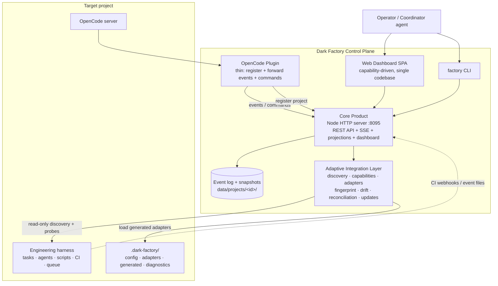
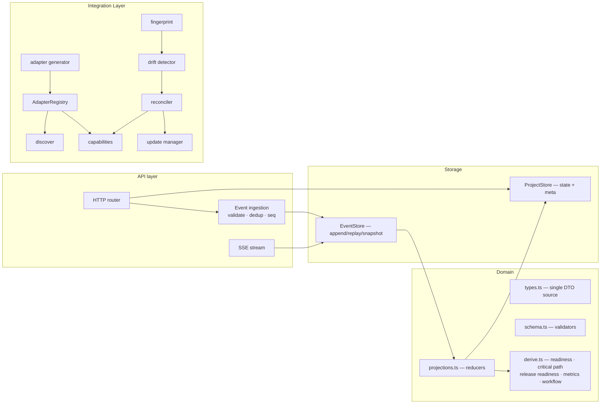

# DFCP Architecture

## 1. Style & rationale

**Modular monolith with an event-sourced core and a plugin-style adapter ring.**
One Node process hosts the Core Product (API + projections + dashboard). Adapters are
modules loaded by the Integration Layer; project-specific adapters live in the target
project and are loaded dynamically. The OpenCode plugin is a thin HTTP client + event
forwarder. No microservices, no message broker, no external database: the append-only
event log *is* the database, and projections are rebuildable from it.

Zero runtime dependencies (Node ≥ 22.18 native TypeScript execution). TypeScript sources
run directly; the dashboard bundle is produced by Node's built-in type stripper.

## 2. C4 — Container diagram



## 3. C4 — Component diagram (Core)



## 4. Data model

Single typed source: `packages/core/src/types.ts`. Entities (per project):

- **Project** `{id, name, root, registeredAt, pluginVersion?, coreVersion}`
- **Task** `{id, title, kind: epic|feature|task|subtask, parentId?, status (normalized),
  sourceStatus?, priority, assignee?, componentId?, dependencies[], acceptanceCriteria[],
  progress?, estimateHours?, estimateConfidence?, labels[], source: SourceRef,
  mapping {ruleSetVersion, confidence, original}, links {branches, prs, runs, release},
  createdAt, updatedAt, history[]}`
- **TaskDependency** — embedded `dependencies[]` + projection-derived reverse index.
- **Agent** `{id, name, role?, kind: opencode|harness|human|unknown, status: working|waiting|
  blocked|reviewing|completed|failed|stopped|unknown, statusEvidence: event|heartbeat|inferred,
  currentTaskId?, sessionId?, model?, startedAt?, lastEventAt?, lastHeartbeatAt?, errors[]}`
- **AgentSession** `{id, agentId, opencodeSessionId?, startedAt, endedAt?, model?, taskIds[]}`
- **Component** `{id, name, parentId?, kind, status, readiness?, doc?, source, metrics?}`
- **Branch / PullRequest** `{name, headSha?, taskIds?, ...}` / `{id, title, state, sourceBranch,
  targetBranch, taskId?, checks[], url?}`
- **Pipeline / PipelineRun / PipelineStage** `{id, name, provider}` / `{id, pipelineId, number,
  status, trigger?, taskId?, branch?, startedAt, finishedAt?, stages[]}` / `{name, status,
  jobs[], startedAt?, finishedAt?, log?}`
- **MergeQueue / MergeQueueEntry** `{id, source}` / `{id, position, branch, taskId?, agent?,
  state: waiting|checking|ready|merging|merged|conflict|dead_letter|failed, checks[],
  enqueuedAt, waitMs?, reason?}`
- **Release** `{id, name, tag?, scopeTaskIds[], status: planning|in_progress|ready|released|
  cancelled, targetDate?, readiness (derived), history[]}`
- **ActivityEvent** — the event log itself, queryable.
- **MetricSnapshot** `{at, metrics: {...}, coverage: {...}}`
- **Integration / Adapter / AdapterVersion / AdapterMapping** — see §6.
- **HarnessFingerprint / Capability / CapabilityManifest / SyncStatus** — see §6.

**SourceRef** `{adapterId, sourceId, entityKind, authoritative: boolean, fetchedAt}` is attached
to every externally-sourced record. Normalization rule: *normalize what is common, preserve
what is project-specific* — `status` + `sourceStatus` + `mapping` always travel together.

**Planning & activity analytics (server-side):** `criticalPath()` additionally returns a
forward-pass Gantt `schedule[]` (start/end working hours per open task, critical-path flag,
estimated-duration flag), `horizonHours`, `projectedFinishAt`, and — when a release scope with
`targetDate` is given — `releaseTargetAt` + `lateByHours`. Placeholder durations (mean of known
estimates) are used only when estimates are missing and are explicitly flagged.
`repoActivity()` buckets git commits and ingested events per day (14-day window) for the
repository-activity chart; both are exposed via `GET /api/projects/:id/critical-path`,
`/git` and `/metrics`.

## 5. Event contracts

Envelope (all events):

```ts
{
  eventId: string          // core-assigned ULID-like, unique
  idempotencyKey?: string  // source-provided dedup key (adapter + source entity + revision)
  projectId: string
  type: string             // namespaced, e.g. task.status_changed
  schemaVersion: number    // per type, registered in schema.ts
  occurredAt: string       // source clock
  ingestedAt: string       // core clock
  seq: number              // per-project monotonic, core-assigned
  source: SourceRef
  payload: unknown         // validated against the registered schema
}
```

Processing guarantees: validation → dedup (eventId + idempotencyKey) → seq assignment →
append → projection → SSE notification. Unknown types are stored as `diagnostic.unknown_event`;
schema-incompatible events are rejected with a `diagnostic.schema_violation` record (the raw
envelope is kept in diagnostics, never applied). Replay rebuilds projections deterministically;
snapshots accelerate startup and are verified against the log tail.

Event families (v1): `project.*`, `task.*`, `agent.*`, `session.*`, `component.*`, `git.*`,
`pipeline.*`, `merge_queue.*`, `release.*`, `workflow.*`, `integration.*`, `diagnostic.*`.
Full registry: `docs/specs/event-contracts.md` (generated from `schema.ts`).

## 6. Adaptive Integration Layer

### 6.1 Discovery (read-only)
Detector set scans the target project for **evidence**, not just filenames: OpenCode config,
agent/skill definitions, workflow scripts (content patterns), task stores (JSON/JSONL/MD with
task-like structure), Git strategy, CI configs (GitHub/GitLab/Jenkins/other), merge-queue
mechanisms, release planning artifacts, architecture sources (LikeC4 model exports), event/log
sources. Each detector emits `Evidence {kind, path, confidence, snippet}`. Discovery never
executes project code. Output: `DiscoveryReport`.

### 6.2 Capability verification
Draft capabilities from discovery are **verified by adapter probes** (real read of the
interface: parse the file, call the API, run `git rev-parse`). Only a successful probe upgrades
a capability to `supported`; partial reads → `partial` with limitations; found-but-unreadable →
`not_configured`/`degraded`; absent → `unavailable`. Manifest records source, adapter,
operations, events, observable states, completeness, lastSyncAt, confidence, contractVersion.

### 6.3 Adapter model

```ts
interface Adapter {
  manifest: AdapterManifest   // id, version, kind, capabilities, contractVersion, compatibility
  probe(ctx): Promise<ProbeResult>
  collect(ctx): Promise<NormalizedEvent[]>   // pull; events carry original + normalized values
  subscribe?(ctx, emit): Promise<() => void> // push sources (optional)
  operations?: Record<string, OperationDef>  // write ops, each with a permission tier
}
```

- **Built-in:** `git`, `opencode` (push), `file-task-tracker` (configurable mapping),
  `jenkins`, `github`, `gitlab`, `likec4`, `merge-queue-file`, `generic-events`.
- **Generated:** written by the Setup Agent into `.dark-factory/adapters/*.adapter.ts`,
  same contract, contract-tested before activation, versioned, rollback-able.
- **Composite:** integration config assigns several adapters to one capability domain with an
  explicit `authoritative` source and conflict strategy (`authoritative-wins` default).

### 6.4 Fingerprint → Drift → Reconciliation → Update

```
install ──► IntegrationBaseline (hashes of harness-relevant files, adapter versions,
            capability manifest, contract versions, agents, stages; NO secrets)
periodic / on-demand ──► re-hash fingerprinted files + contract checks + sync staleness
change ──► DriftReport {changes[], category A|B|C, impact}
A (safe compatible) ──► auto-apply + verify
B (structural reversible) ──► prepare adapter/mapping update → tests → diff → switch → verify → rollback-ready
C (breaking/high-risk) ──► plan + explicit approval required
```

Drift detection is economical: only fingerprinted harness files are hashed (business code is
excluded); full discovery re-runs only on structural signals or explicit `factory:reconcile`.
Adapter failure isolates its capabilities (`degraded`/`stale` + lastSuccessAt); other adapters
continue. History is never deleted by reconciliation; mappings are versioned.

### 6.5 Target-project integration directory

```
target-project/.dark-factory/
  config/project.yaml(.json)     # registration, sources, authoritative strategy, permissions
  config/capabilities.json       # last verified Capability Manifest
  adapters/*.adapter.ts          # generated project-specific adapters (versioned)
  adapters/history/              # previous versions (rollback)
  generated/integration-manifest.json
  generated/install-manifest.json# every file DFCP created/modified (for uninstall)
  diagnostics/                   # probe results, drift reports, sync logs
```

## 7. OpenCode plugin (thin)

- `setup(ctx)`: resolve project via `ctx.location`; register with Core (`POST /api/projects`);
  subscribe `ctx.event.subscribe` + `ctx.tool.hook("execute.after")`; map OpenCode events to
  DFCP `agent.*`/`session.*`/`activity.*` events; batch-forward with idempotency keys;
  periodic heartbeat of session/agent state; cleanup aborts streams and timers.
- Tools (namespace `factory`): small HTTP passthroughs to Core operations.
- Commands: `/factory-*` set + `/factory <subcommand>`.
- Agents/skills: markdown definitions installed into `.opencode/agent/`, `.opencode/skills/`
  by the installer (tracked, reversible).
- No business logic, no storage, no orchestration in the plugin.

## 8. Deployment

- Default: single local process, `127.0.0.1:8095` (configurable), data dir `~/.dfcp` or
  `--data`. Multiple projects share one core; storage isolated per project.
- CLI can auto-start/stop the core (pid file + health probe). Docker optional later.
- Dashboard served by the core (built SPA assets). SSE for live updates; polling fallback.

## 9. Key decision records

| ADR | Decision | Why |
|---|---|---|
| 001 | Event-sourced append-only log instead of mutable state doc | Legacy root cause RC1: lost updates, no history/replay |
| 002 | Core independent of OpenCode; plugin = thin client | RC2; product must run standalone |
| 003 | Discovery + probes + capability manifest instead of hardcoded paths | RC3; arbitrary harnesses |
| 004 | Single DTO source (types.ts) + validators + contract tests; all derivation server-side | RC4; legacy duplicated rollups drifted |
| 005 | Capability-driven single-codebase UI | RC5; never show unsupported as working |
| 006 | Observation separated from orchestration; writes are explicit permission-scoped operations | RC6; legacy control loops poisoned monitoring |
| 007 | Zero runtime dependencies; Node native TS | npm registry unreachable in dev env; maximal portability; simple supply chain |
| 008 | Adapter categories A/B/C with rollback and history preservation | Safe autonomous maintenance of integrations |
| 009 | File-based per-project storage (JSONL + snapshots) | Minimal architecture; adequate for local-first v1; upgrade path to SQLite later without contract changes |
