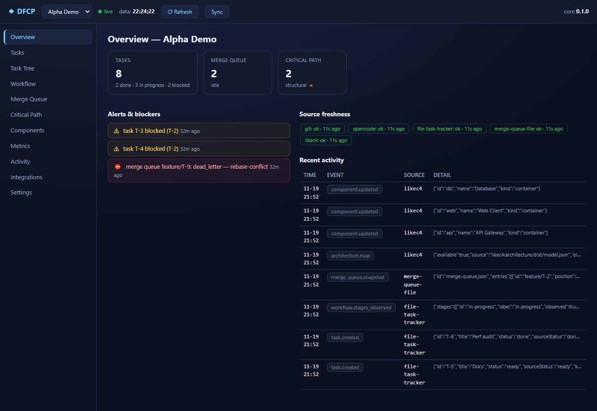
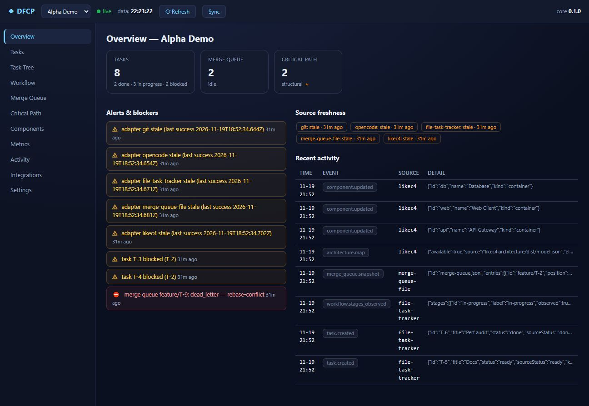
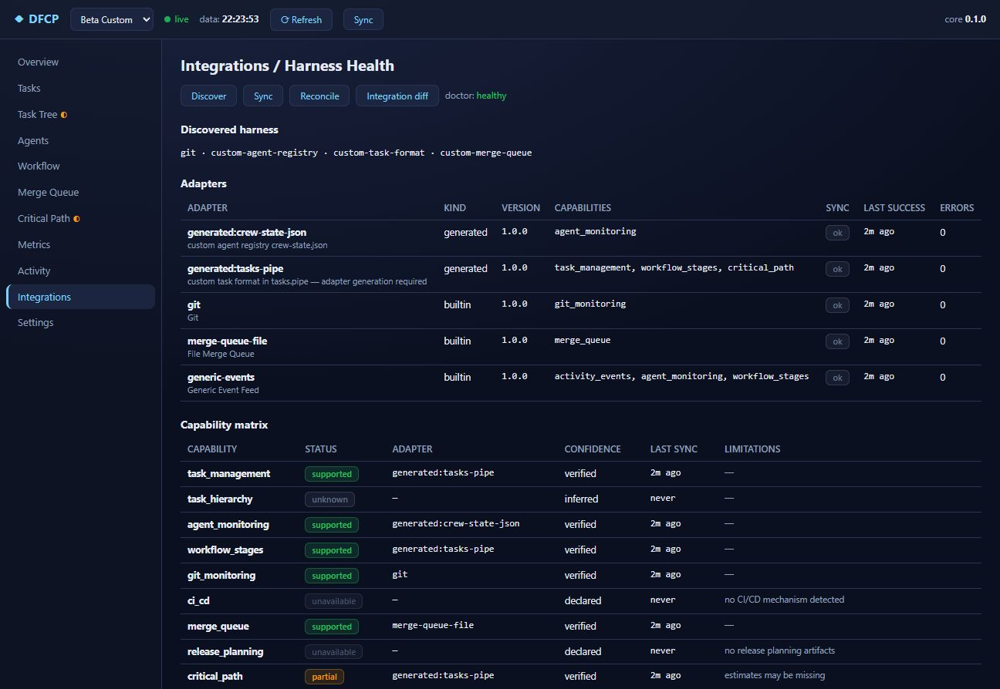
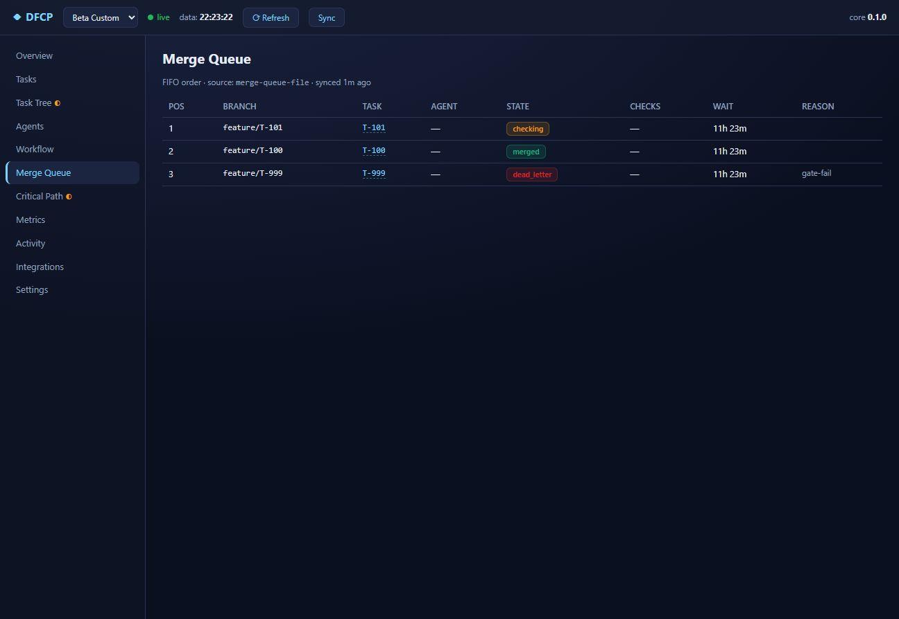
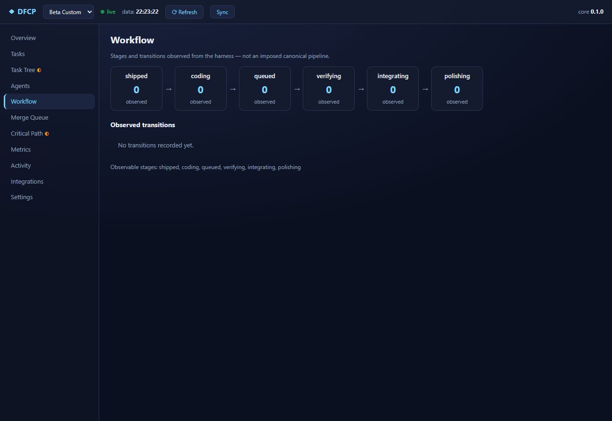
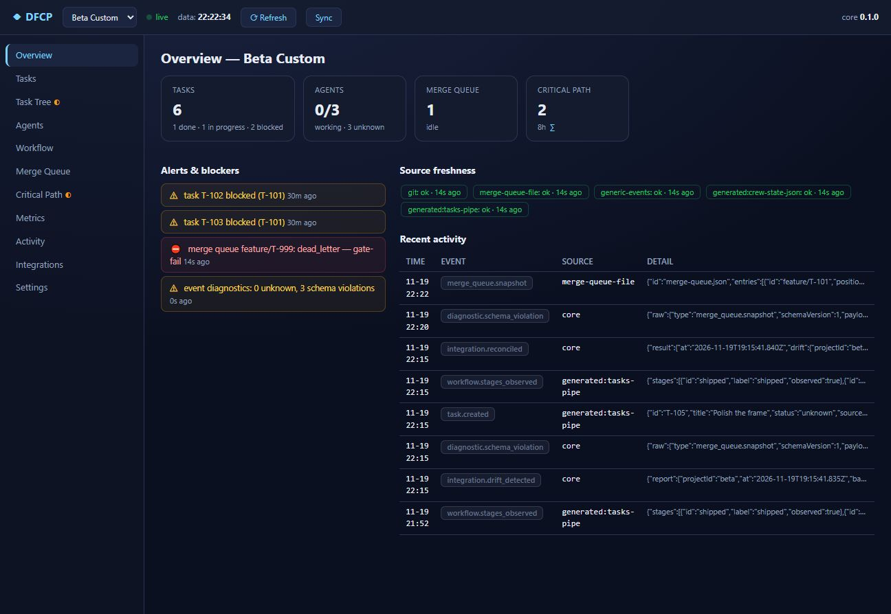

# Harness Adaptation Demonstration

Two synthetic projects with **substantially different harnesses** were connected to a live
DFCP instance (Core v0.1.0, http://127.0.0.1:8095) using only the product's own setup flow.
All screenshots below were captured from the running dashboard.

Fixtures: `tests/fixtures/build.ts` (built into `tests/.runtime/demo/`, gitignored).
Automated coverage of the same flows: `tests/integration/adaptive.test.ts`, `tests/e2e/product.test.ts`.

---

## Project A — "Alpha Demo": standard OpenCode harness

Harness: OpenCode config + agent definitions + skills, Git, JSON task tracker, Jenkinsfile,
file-based merge queue, LikeC4 model export, release plan.

### Discovery → Capability Manifest (automatic)

`factory setup --root …/alpha` detected: `git, opencode, opencode-skills, file-task-tracker,
jenkins, custom-merge-queue, likec4` and produced:

| Capability | Status | Adapter |
|---|---|---|
| task_management / task_hierarchy / workflow_stages / critical_path | supported | file-task-tracker |
| git_monitoring | supported | git |
| merge_queue | supported | merge-queue-file |
| architecture_map | supported | likec4 |
| agent_monitoring | **not_configured** | opencode (plugin not connected — honest) |
| ci_cd | **unknown** | Jenkinsfile found, URL not configured — honest |
| release_planning | unknown | artifact found, scope extraction pending |

Overview: 8 tasks (2 done / 3 in progress / 2 blocked), merge queue 2, critical path 2
(structural ≈ — estimates incomplete for some tasks, labeled as such), blockers and
dead-letter alert, per-source freshness badges, live activity stream.

### Freshness honesty

After a core restart (before the next sync) the same screen badges every source `stale`
with its last-success timestamp and raises alerts — data is shown as last-good, never as
current fact:

### Plugin connection (simulated over the same HTTP surface the plugin uses)

`POST /api/projects/alpha/plugin/connect` upgrades `agent_monitoring` to `supported`;
agent/session events (`agent.registered`, `session.started`, `agent.status_changed`,
`agent.heartbeat`) flow through `POST /api/projects/alpha/events` with idempotency keys
(duplicate delivery verified as no-op in E2E).

---

## Project B — "Beta Custom": substantially different custom harness

Harness: **no OpenCode, no CI, no LikeC4**. Custom pipe-delimited task file (`tasks.pipe`)
with its own vocabulary (`queued / coding / verifying / integrating / shipped`), custom crew
registry (`crew-state.json`), custom queue fields (`ref / ticket / phase`), JSONL event feed.

### Discovery → adapter GENERATION (automatic)

Discovery classified the sources as `custom-task-format`, `custom-agent-registry`,
`custom-merge-queue` and **generated two project-specific adapters**, contract-tested in
isolation before activation:

- `generated:tasks-pipe` (task-lines parser + status mapping) → task_management,
  workflow_stages, critical_path;
- `generated:crew-state-json` (registry mapper) → agent_monitoring.

Capability matrix: `ci_cd: unavailable (no CI/CD mechanism detected)`,
`release_planning: unavailable`, `task_hierarchy: unknown`, `critical_path: partial
(estimates may be missing)` — nothing fabricated, everything explained.

### Custom semantics preserved

`T-101` normalized `coding → in_progress` with `sourceStatus: "coding"` and
`mapping.original` preserved; crew agent `welder-1` → `working` on `T-101`, `painter-1` →
`waiting`. The queue's custom fields were auto-detected (`ref/ticket/phase`) and mapped
(`gates → checking`, `done → merged`, `dead-letter → dead_letter` with reason `gate-fail`):

### Harness evolution → drift → reconciliation (live)

A new stage was added to the harness after installation (`T-105 … polishing`):

1. `factory diff --project beta` → `workflow_stage_added: "polishing" appeared` (category B).
2. `factory reconcile --project beta` → actions applied, `manifestUpdated: true`,
   `verified: true`; baseline retaken; history preserved (event log grew, nothing deleted).
3. `T-105` ingested with `status: unknown`, `sourceStatus: "polishing"`,
   `mapping.confidence: unmapped` — semantics NOT invented; limitation surfaced.
4. Workflow view now shows the project's OWN stages, including the new one:

The full drift/reconcile/diagnostic trail is visible in the Activity stream
(`integration.drift_detected`, `integration.reconciled`, `diagnostic.schema_violation`,
`task.created`), and the Overview reports it as an alert:

### Contract enforcement observed live

During the demo an early adapter version emitted queue snapshots with an unmapped branch
field; the core **rejected** them as `diagnostic.schema_violation` (raw preserved, state
untouched) and surfaced the alert. After the adapter fix, sync recovered automatically —
demonstrating failure isolation and honest degradation without data corruption.

### Adapter update / rollback (verified in E2E)

`adapter:update` contract-tests and activates a new generated version (history archived);
a broken version is refused; `adapter:rollback` restores the previous working version and
re-verifies. Covered by `tests/e2e/product.test.ts` over HTTP.

---

## What this demonstrates (Definition of Done anchors)

- Automatic discovery of two different harnesses; no project was reshaped to fit DFCP.
- Capability Manifest with probe-verified statuses; unsupported features never shown as working.
- Built-in adapter selection AND project-specific adapter generation with contract tests.
- Capability-driven dashboard: one codebase, two different section sets
  (Alpha: Components/architecture; Beta: none — honest unavailable states).
- Custom status normalization with original preservation; unmapped → unknown.
- Drift detection → reconciliation → manifest/mapping update → history preservation.
- Failure isolation, stale/degraded honesty, idempotent ingestion, diagnostic quarantine.
- Adapter versioning with tested updates and rollback.
