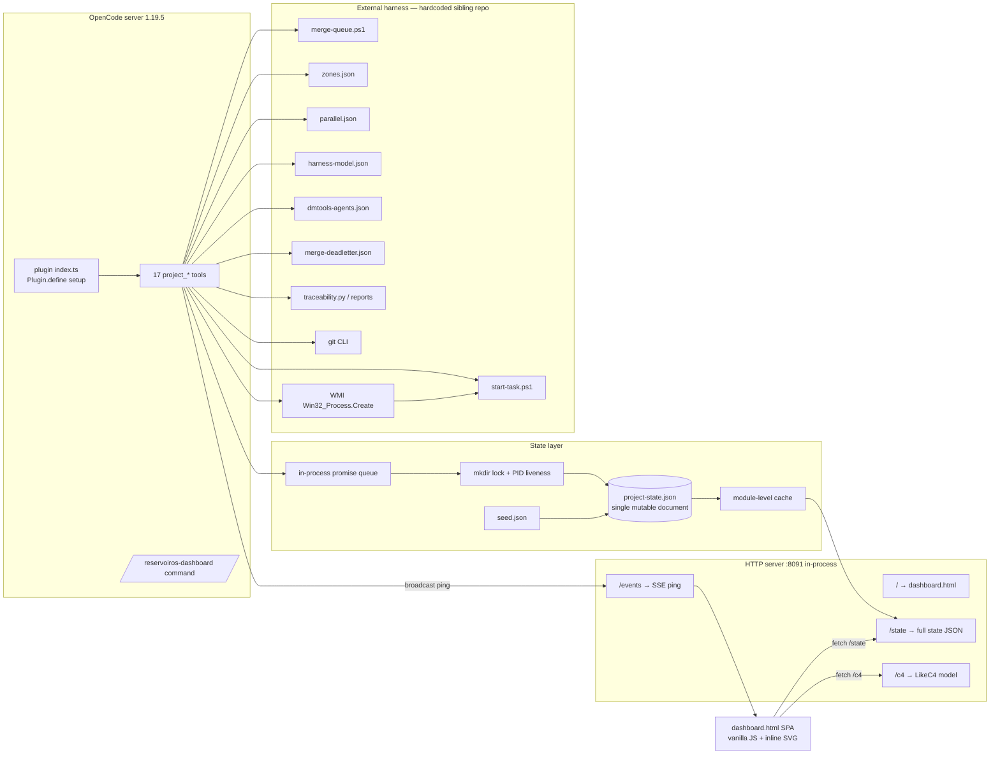

# Reverse Engineering Report — Legacy Engineering Dashboard Plugin

**Subject:** `reservoiros-dashboard` OpenCode plugin (v1.0.0) and the companion `harness-viz` plugin.
**Method:** read-only source analysis of an isolated snapshot (`research/legacy-plugin-snapshot/`,
`research/legacy-plugin-live/`). No original repository was modified. Platform: OpenCode **1.19.5**
(V2 plugin API, `@opencode/plugin`).

This report reconstructs the as-built architecture, catalogs defects with evidence, identifies
architectural root causes, and records migration decisions for the Dark Factory Control Plane (DFCP).

---

## 1. Inventory

| File | Size | Role |
|---|---|---|
| `index.ts` | 70.8 KB / 1051 lines | Monolith: plugin entry, 17 tools, 1 command, HTTP+SSE server, state manager, concurrency control, derived metrics, 4 autonomy loops, external process orchestration |
| `dashboard.html` | 45.3 KB / 492 lines | Self-contained SPA: component tree, drill-down, SVG graphs (UML-styled), task modal, SSE client, **duplicated** metric rollup logic |
| `state-io.js` | 4.2 KB | BOM-tolerant JSON parse + non-destructive corruption recovery (backup + journal + re-seed) |
| `seed.json` | 13.8 KB | Initial state: architecture tree + 13 seed tasks + `schemaVersion` field (never enforced) |
| `diagrams-server.mjs` | 2.6 KB | Standalone LikeC4 model server, port 8092 (legacy path; plugin also serves `/c4` on 8091) |
| `tests/test_state_io.js` | 4.8 KB | 5 unit tests for state recovery |
| `tests/test_dispatch_logic.mjs` | 5.7 KB | Unit tests for dispatcher claim logic |
| `harness-viz/*` | 21 KB + 3.8 KB | Second plugin: generates `harness-viz.html` from `harness-model.json` |

Registered tools (namespace `project`): `dashboard_open`, `component_update`, `task_create`,
`task_update`, `architect_review`, `dispatch`, `task_claim`, `task_release`, `report_tests`,
`report_task_tests`, `report_crap`, `agent_heartbeat`, `merge_enqueue`, `merge_status`,
`merge_process`, `merge_release`, `release_candidate`, `resolve_conflicts`.
Command: `/reservoiros-dashboard`.

## 2. Reconstructed architecture

### 2.1 Component diagram



### 2.2 Data flow

1. Agent calls a `project_*` tool → `mutate(proj, fn)`:
   in-process queue → cross-process `mkdir` lock (PID liveness, 60 s stale fallback) →
   **fresh full read** of `project-state.json` → in-place mutation → `updated` timestamp →
   per-PID tmp file + `rename` → cache update → SSE broadcast.
2. SSE carries only `{type:"state", updated}` — a *ping*. The SPA reacts by re-fetching the
   **entire** `/state` document and re-rendering everything (`innerHTML` rebuild).
3. `/state` merges three sources at read time: the state document, the DMTools agent registry
   file (BOM-stripped), and `git log -1` timestamps of two repos ("data updated" heuristic).
4. External edits to the state file are picked up by `fs.watch` (BOM-strip fix added after an
   incident where the cache stayed stale forever).

### 2.3 Event flow (as built)

There is **no event model**. Tools are imperative mutations. The only async signal is the SSE
ping. Consequences: no event IDs, no dedup, no ordering guarantees, no replay, no history,
no gap detection. A journal exists solely for corruption-recovery records.

### 2.4 State management

- One JSON document = the entire world (architecture tree, tasks map, agents map).
- `cache` + `cacheProj` module globals; some code paths bypass the cache (`autoRecover` does a
  fresh `loadState`) because the cache was repeatedly stale — two read paths with different
  freshness guarantees.
- Concurrency: promise queue (in-process) + `mkdir` lock (cross-process) + PID liveness +
  per-PID tmp. This stack was built incident-by-incident (shadow worktree state, lost updates,
  lock-sniping takeover storm with 8 concurrent merges, BOM parse failures).
- Recovery: `state-io.js` preserves corrupt files as `.corrupt-<ts>` backups + journal entry
  before re-seeding (non-destructive; added after loss of 45+ tasks).

### 2.5 Dependency graph (runtime)

```
index.ts
├─ @opencode/plugin (Plugin.define, ctx.tool/command.transform, ctx.session.prompt)
├─ node:http, node:fs, node:child_process, node:path, node:url
├─ ./state-io.js
├─ ./seed.json, ./dashboard.html (served verbatim)
├─ git CLI (PATH or hardcoded C:\Program Files\Git\cmd\git.exe)
├─ powershell.exe (hardcoded system path) + WMI/CIM (detached process launch)
├─ opencode-cli.exe (discovered under %APPDATA%\ai.opencode.desktop\cli)
├─ python.exe (tools\python39) → traceability.py
└─ sibling repo files: merge-queue.ps1, start-task.ps1, zones.json, parallel.json,
   harness-model.json, .locks/*.json, reports/*.json, oracle/reports/suite-report.json
```

Every external dependency is resolved by **hardcoded convention**
(`join(dirname(proj), "ReservoirOS-harness")` appears in 12+ places), Windows-only.

## 3. Defect catalog

| # | Defect | Evidence | Impact |
|---|---|---|---|
| D1 | Monolithic plugin: observation + control + orchestration + HTTP + UI glue in one file | `index.ts` 1051 lines, 4 `setInterval` autonomy loops | Cannot run without OpenCode; untestable; unportable |
| D2 | Single mutable state document, no event log | `mutate()` read-modify-write of whole JSON | Lost updates (incident T-020: 45+ tasks lost), no history/replay/audit |
| D3 | No schema versioning or validation | `schemaVersion` in seed unused; everything typed `any` | Silent DTO drift, corrupt-state incidents |
| D4 | Derived logic duplicated server/client | `STAGE_FLOOR`, `taskProgress`, readiness rollup in both `index.ts` and `dashboard.html` with **different** leaf-inheritance rules | UI and API disagree; drift on every change |
| D5 | Hardcoded project topology & OS | `"ReservoirOS-harness"` sibling path ×12; `C:\Program Files\Git`; PowerShell; WMI | Zero adaptability to other projects/OS |
| D6 | Shadow-state worktree problem | `resolveProject()` git-common-dir redirect + `crates/` existence heuristic | Sessions wrote to shadow state; dispatcher stalled (incident 2026-11-17) |
| D7 | Event loss by design | SSE = ping only; full-state refetch | No dedup/order/replay; missed mutations invisible |
| D8 | Agent liveness inferred, not observed | `agentState()` = task.status + owner + 15-min heartbeat staleness; two registries with different semantics | Absence of heartbeat ≠ completion; no session/model linkage; false "active"/"done" |
| D9 | Side effects inside tool handlers | `task_update` → architectReview (spawns python) + dispatch + autoMerge; `merge_process` once blocked the whole service 20–35 min (audit F-14) | Latency, coupling, cascading failures |
| D10 | No capability model | UI always renders every section; C4 absence → stub text | Unsupported features look operational; fictional empty states |
| D11 | No CI/CD domain model | Only gate pass/fail JSON; Jenkins mentioned in docs only | No pipelines/runs/stages/jobs observability |
| D12 | No release / critical-path model | `release_candidate` delegates to script; no dependency-graph analysis | Release readiness opaque |
| D13 | No permission model | WMI process spawn, writes into sibling harness repo, python execution | Uncontrolled side effects; unsafe for arbitrary projects |
| D14 | Minimal tests | 2 unit files (~10 tests); no contract/integration/e2e | Regressions found in production (audit list C1–C10, F-14) |
| D15 | Two freshness paths | `getState` cache vs fresh `loadState` in `autoRecover` (audit C1/C10: stale cache resurrected done tasks every ~20 min) | Actions on obsolete state |
| D16 | Lock sniping | plugin + watchdog + drain inspected/renamed `merge.lock` → 8 concurrent merges (audit 2026-11-19) | Integration corruption |
| D17 | DTO inconsistency | `tests` shape differs task vs component; coverage weight falls back to test-count (marked `≈`) mixing precision levels | Misleading aggregates |
| D18 | Fixed ports, silent failure | 8091/8092 hardcoded; `server.on("error")` silently closes | Collisions; dashboard "connecting…" forever |
| D19 | Single project per process | server bound to first resolved `proj`; cache keyed but server not | No multi-project support |
| D20 | In-memory recovery counters | `recoverCounts` Map lost on restart | Relaunch loops across restarts |

## 4. Architectural root causes

- **RC1 — State-centric, not event-centric.** A mutable document as the source of truth makes
  history, replay, dedup and multi-writer consistency impossible without bolted-on locks.
- **RC2 — Plugin-as-application.** All business logic lives inside the OpenCode plugin; the
  product cannot exist without a live OpenCode session.
- **RC3 — Integration by hardcoded convention.** No discovery, no contracts, no adapters;
  the "integration" is a set of filesystem paths and process commands for one specific harness.
- **RC4 — Untyped boundaries.** `any`-typed DTOs and duplicated computations across layers
  guarantee drift; there are no contract tests.
- **RC5 — UI not capability-driven.** Every screen renders regardless of whether the underlying
  source exists or is healthy.
- **RC6 — Observation mixed with orchestration.** The monitoring tool also dispatches agents,
  merges branches and spawns resolvers; failures of control loops poison observation.

## 5. Migration decisions (legacy → DFCP)

**Kept (as ideas, re-implemented):**
- Task graph with dependencies, statuses, priorities, per-task test reports; readiness rollup
  over a component tree (single implementation, server-side, exposed via API).
- Heartbeat-based agent activity **plus** explicit lifecycle events; staleness shown as
  `Unknown`, never as completion.
- Merge-queue UX (FIFO order, per-entry checks, dead-letter reasons) — as an adapter-backed
  view, not a hardcoded script call.
- Non-destructive corruption recovery (backup + journal) — generalized to event-store integrity.
- Cross-process write-safety lessons — replaced by single-writer event log + append-only writes.
- LikeC4 as an *optional* architecture source with honest "not available" state.

**Rewritten from scratch:**
- Event-sourced core (append-only log, typed versioned events, idempotent ingestion, projections,
  replay) instead of a mutable JSON document.
- Standalone Core Product (HTTP API + storage + dashboard) independent of OpenCode.
- Adaptive Integration Layer: discovery → capability manifest → adapter registry → mapping →
  fingerprint/drift/reconciliation/update manager.
- Capability-driven single-codebase dashboard.
- Typed DTO contracts + contract tests at every boundary.

**Dropped (not migrated):**
- WMI/PowerShell detached process spawning, hardcoded absolute paths, `crates/` heuristics.
- Dispatcher / auto-merge / auto-resolver / auto-recover loops inside the monitoring tool.
  DFCP is an observability + work-management product; orchestration stays in the project's
  harness. Write operations (task create/update/claim) are explicit, permission-scoped Core API
  operations with a declared authoritative source — never implicit side effects of observation.
- Fixed-port singleton server; in-memory recovery counters; duplicated client-side rollups.

## 6. OpenCode V2 plugin API surface used (verified against 1.19.5 docs)

- `Plugin.define({ id, setup(ctx) })`, cleanup via returned function.
- `ctx.tool.transform(editor => { editor.namespace(...); editor.add({ name, description, input, options:{namespace, codemode}, execute }) })`.
- `ctx.command.transform(editor => editor.add({ name, description, execute({sessionID, prompt, delivery}) }))`.
- `ctx.session.prompt`, `ctx.session.create/get/list`, `ctx.agent.list/get`, `ctx.storage.get/set`.
- `ctx.event.subscribe({ types, signal })` — async iterable of typed server events (the correct
  source for agent/session monitoring, absent in the legacy plugin).
- `ctx.tool.hook("execute.before" | "execute.after")`, `ctx.session.hook("prompt" | "context" | ...)`.
- `ctx.permission.assert` — permission-scoped actions (absent in legacy).
- `ctx.location.directory` / `ctx.location.project` — project identity (legacy used cwd heuristics).
- Plugin loading: `.opencode/plugins/<dir>/` auto-discovery or `plugins[]` in `opencode.json(c)`;
  package form `{ package, options }`; `ctx.options` for configuration.

The legacy plugin used only transforms + commands; it never subscribed to the event stream,
never used hooks, permissions, agent/session APIs or storage — the richest observability
surfaces of the platform were unused.
